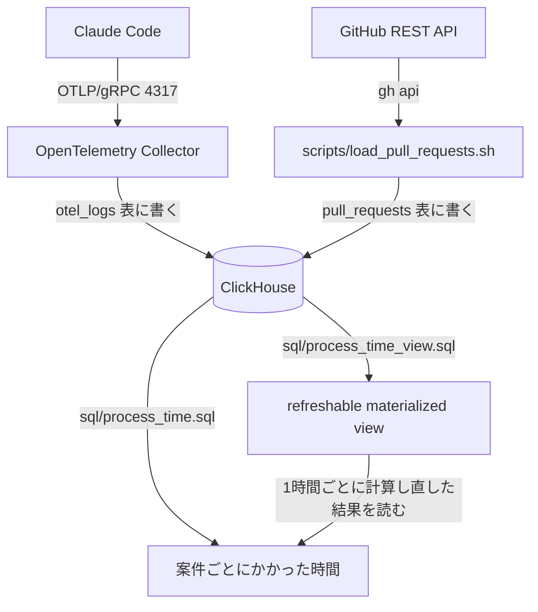

# process-time-clickhouse-platform

Claude Code と GitHub のデータから開発の工程ごとにかかった時間を出す ClickHouse + OpenTelemetry Collector の基盤

## 構成



## 使い方

`~/.claude/settings.json` の `env` に次を足して Claude Code の送り先を OpenTelemetry Collector に向ける

```json
{
  "env": {
    "CLAUDE_CODE_ENABLE_TELEMETRY": "1",
    "OTEL_LOGS_EXPORTER": "otlp",
    "OTEL_METRICS_EXPORTER": "otlp",
    "OTEL_EXPORTER_OTLP_PROTOCOL": "grpc",
    "OTEL_EXPORTER_OTLP_ENDPOINT": "http://localhost:4317",
    "OTEL_METRICS_INCLUDE_REPOSITORY": "true",
    "OTEL_LOG_TOOL_DETAILS": "1"
  }
}
```

```bash
# ClickHouse と OpenTelemetry Collector を立てる
docker compose up -d

# GitHub の PR の時刻を取り込む
scripts/load_pull_requests.sh owner/repo

# 案件ごとにかかった時間を出す
docker compose exec -T clickhouse clickhouse-client --multiquery < sql/process_time.sql

# 同じ集計を1時間ごとに計算し直す refreshable materialized view を作る
docker compose exec -T clickhouse clickhouse-client --multiquery < sql/process_time_view.sql

# 止める
docker compose down
```
